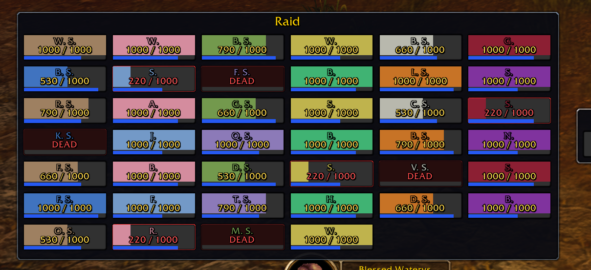

# Healing Rain

Raid frames for healers in **WoW: Forever** (client folder `_forever_`), with editable click healing, mouse-wheel and hover keys.

- Solo: shows just your own square.
- Party: one compact vertical column, sized to the actual members (up to 5).
- Raid: one vertical column per occupied subgroup, sized to the actual members (up to 40).
- Demo buttons let you check a 5-person party or 10/25/40-person raid while solo.
- Optional Target window.
- Click, wheel and hover-key healing you set up yourself.

## Install

1. Download this repo (green **Code** button → **Download ZIP**).
2. Unzip it and rename the folder to `HealingRain`.
3. Put it in `World of Warcraft/_forever_/Interface/AddOns/`.
4. Restart the game, or type `/reload`.

## Commands

Every command works with any of these four names: `/hr`, `/hh`, `/healingrain`, `/healhelper`.
For example, `/hh demo` and `/hr demo` do the same thing.

| Command | What it does |
|---|---|
| `/hr config` | Open the settings window (looks, clicks, wheel, hover keys) |
| `/hr demo5` | Toggle a fake 5-person party: you plus four sample members |
| `/hr demo 10` / `/hr demo 25` / `/hr demo 40` | Toggle a raid preview of that size |
| `/hr demo` | Toggle the 40-player raid preview |
| `/hr demo off` | Turn off any preview and return to your real group |
| `/hr live` | Leave the demo and show your real group again |
| `/hr show` / `/hr hide` | Show or hide the frames |
| `/hr resize` | Unlock or lock the bottom-right resize grip |
| `/hr target` | Turn the Target window on or off |
| `/hr refresh` | Rebuild the roster |
| `/hr clicks` | List your click and wheel heals in chat |
| `/hr help` | List all commands in chat |

**Move the frame:** hold **Alt** and left-drag any square (out of combat). Your position is saved.

Layout changes wait until you leave combat. `/hr config`, `/hr clicks` and `/hr help` work in combat.

## Test the layout without a group

1. Type `/reload`, then `/hr config`.
2. Click **Demo 5-man**. You should see five squares stacked down one narrow column, with varied classes and health. The first square uses your name and class.
3. Hold **Alt** and left-drag a square to move the frame.
4. Click **Unlock size** in settings (or type `/hr resize`). Left-drag the bottom-right grip to resize the squares together. The width and height fields update as you drag. Click **Lock size** when done.
5. Click **Demo raid 10**, **Demo raid 25**, or **Demo raid 40** to check larger layouts: 2, 5, or 8 columns of five.
6. Click the same demo button again, or type `/hr demo off`, to return to normal. While solo, only your own square remains.

Demo squares are previews only: clicks cannot cast heals or target players, and hovering them does not bind healing keys or the mouse wheel. The separate Target window is hidden during demos. Start or stop a demo outside combat. Your normal click bindings and Target preference return afterward.

## Customize (`/hr config`)

### Name style
Click the **Name style** button to cycle through:

| Style | Example |
|---|---|
| Full name | Water Storm |
| Initials | W. S. |
| First name + last initial | Water S. |
| First 3 letters of each | Wat Sto |
| First name | Water |
| Last name | Storm |

### Health text

| Style | Example |
|---|---|
| Percent | 75% |
| Health | 750 |
| Health / maximum | 750 / 1000 |
| Health + percent | 750 (75%) |
| None | (no text) |

### Size
- Click **Unlock size** in settings, or type `/hr resize`. A grip appears at the main frame's bottom-right corner.
- Left-drag the grip to change square width and height live while keeping the party/raid grid. The same saved settings and number fields update automatically.
- Click **Lock size** or repeat `/hr resize` to hide the grip and prevent accidental resizing. Size starts locked.
- **Bar width:** 60 to 240.
- **Bar height:** 32 to 100.
- You can still type sizes in the number fields and click **Save**. Dragging saves size immediately.
- Resize only outside combat. Starting combat stops an active resize. Alt + left-drag still moves the frame.
- Size and lock state are saved for your next `/reload`.

### Target window
Show or hide a separate Target square. It has its own frame and moves on its own with Alt + drag.

### Click healing
Type a spell name for any mouse button, with or without **Shift**, **Alt** or **Ctrl**:
left click, right click, wheel click, side button 1 and side button 2. That's 20 slots.

### Mouse wheel
Set a spell for wheel up and wheel down, with or without Shift, Alt or Ctrl.

### Hover keys
Up to 4 keyboard keys. Press the key while your mouse is over a square to cast that spell on that player.

### Defaults (priest)

| Action | Spell |
|---|---|
| Shift + left click | Flash Heal |
| Alt + left click | Lesser Heal |
| Right click | Dispel Magic |
| Wheel click | Power Word: Fortitude |
| Wheel up | Lesser Heal |
| Wheel down | Flash Heal |

Click **Save** in the settings window to keep your changes.

Author: Audrey (Waterys419)

## Offline checks

From the repository folder, run `lua5.1 tests/runtime.lua` and `lua5.1 tests/runtime.lua HealingRain.lua solo`.
These mock the client API and cover group dimensions, subgroup positions, solo/group transitions, secure drag guards, safe demos, resize limits, per-square scaling, number-field sync, and combat cancellation. In-game mouse/casting checks are still required.
